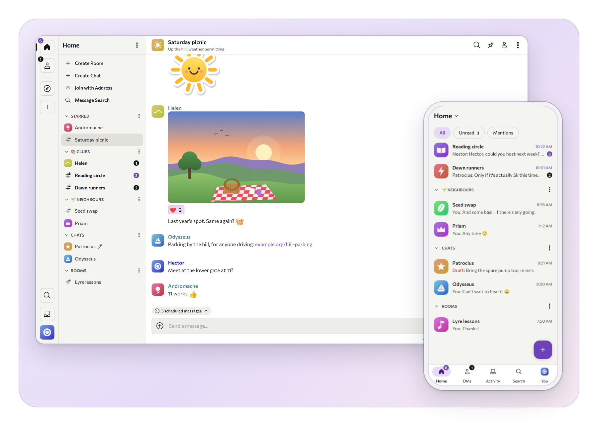
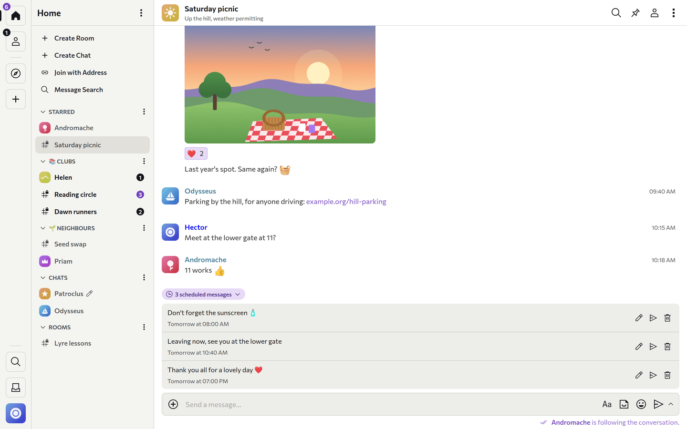
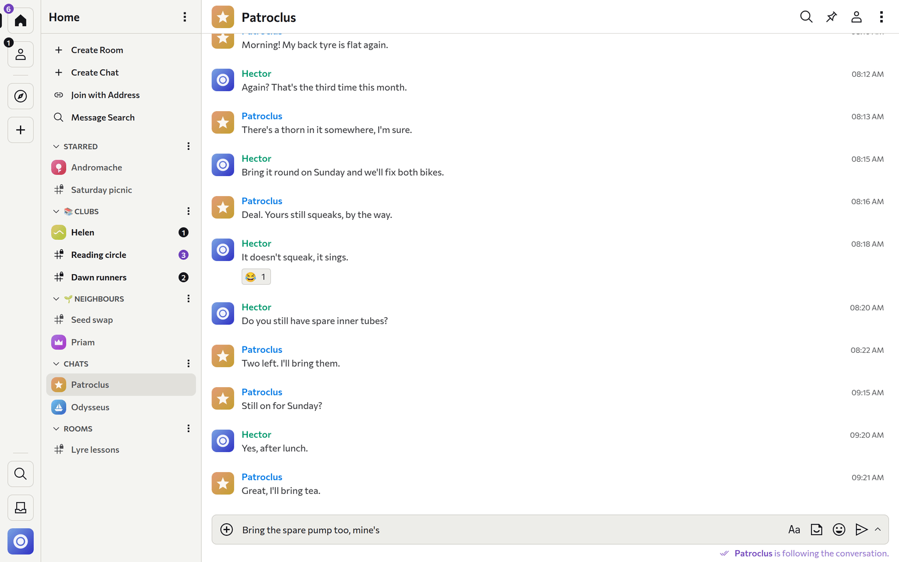
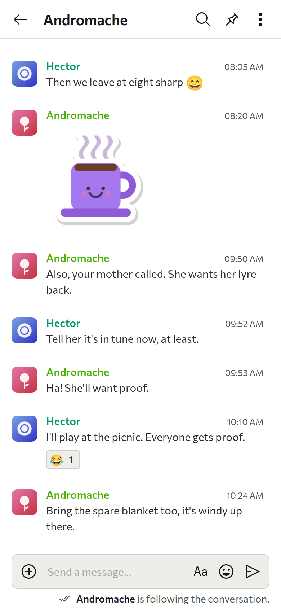
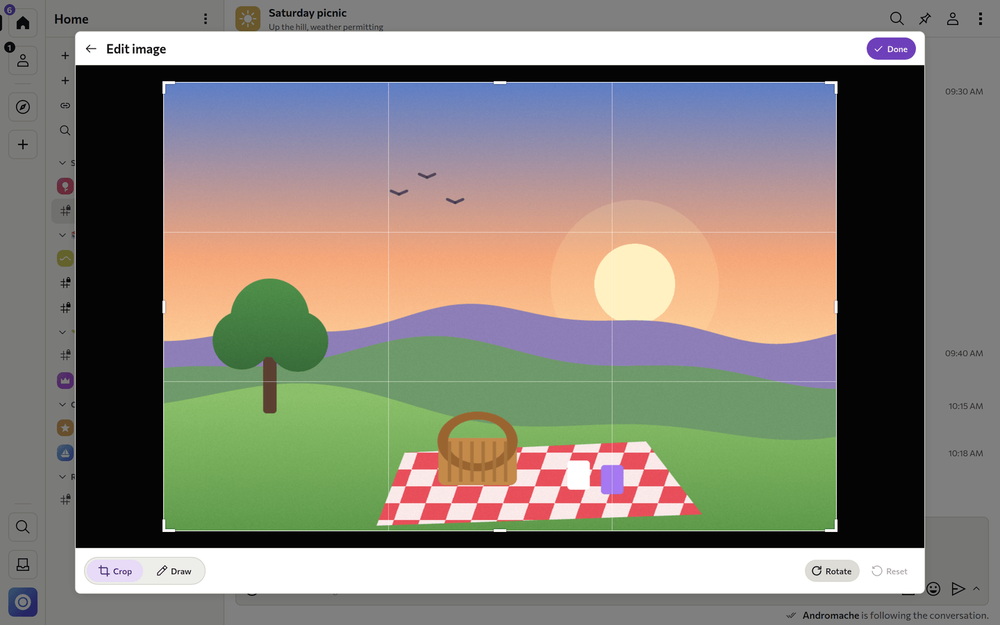
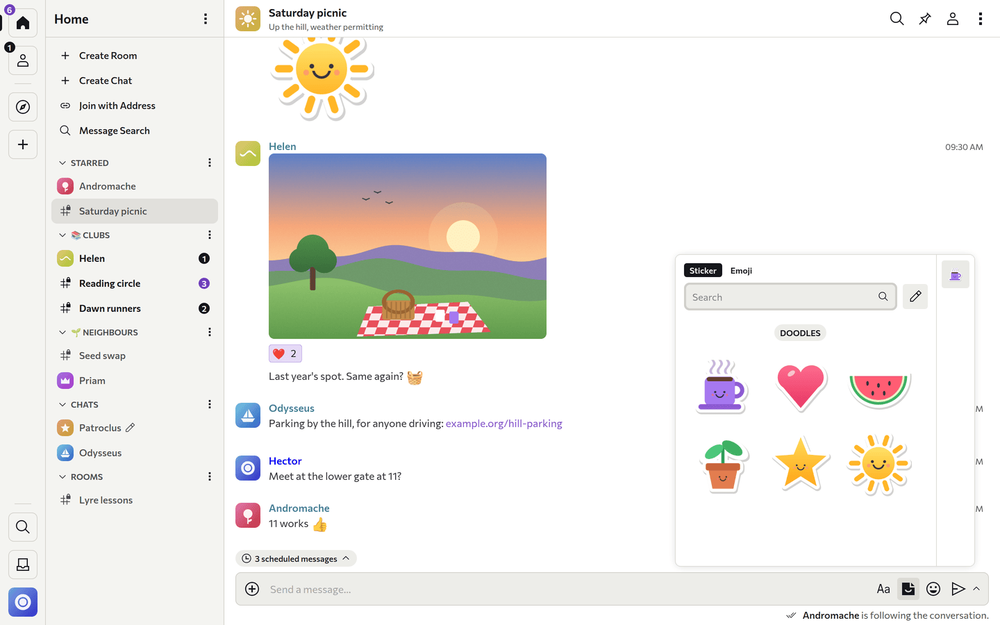

<div align="center">

<h1><picture><source media="(prefers-color-scheme: dark)" srcset="branding/iris-mark-on-dark.svg"></picture> Iris</h1>

<p>A Matrix client built on Cinny, with Home sections, synced drafts and scheduled messages</p>

<p><a href="#what-iris-adds-to-cinny">What Iris adds</a> · <a href="#build-and-run">Build and run</a> · <a href="https://github.com/MouseionHouse/Iris/issues">Issues</a> · <a href="https://github.com/MouseionHouse/Iris/pulls">Pull requests</a> · <a href="CONTRIBUTING.md">Contributing</a></p>

<p><a href="https://github.com/MouseionHouse/Iris/actions/workflows/check.yml"></a> <a href="LICENSE"></a> <a href="https://github.com/cinnyapp/cinny"></a> </p>

<picture><source media="(prefers-color-scheme: dark)" srcset="docs/pictures/hero-dark.png"></picture>

</div>

Iris is a [Matrix](https://matrix.org) client, forked from [Cinny](https://cinny.in) 4.12.6. It follows Cinny, on 4.12.8 now, and adds what one household, Mouseion, wanted from its chat. It runs in the browser, as an Android app, as a KDE Plasma desktop app and as a macOS app.

## What Iris adds to Cinny

- **Sidebar sections on Home.** Starred and your own named sections mix chats and rooms. Each has its own sort and filter, and they sync between your devices.
- **Draft sync.** A message you start on one device waits in the composer on the others, with a draft marker in the room list.
- **Scheduled messages.** Pick a time and the homeserver sends the message then, with the app closed ([MSC4140](https://github.com/matrix-org/matrix-spec-proposals/pull/4140) delayed events; the homeserver must support them).
- **An Android app.** A [Capacitor](https://capacitorjs.com) wrapper around the same web build, with push notifications while the app is closed through [UnifiedPush](https://unifiedpush.org) (with a distributor such as [ntfy](https://ntfy.sh)), a place in the share sheet, and safe areas for notched and folding screens.
- **A touch UI.** Tap or long-press a message for its action sheet, menus as bottom sheets, and rows and targets sized for fingers.
- **An image editor.** Crop, rotate and draw on an image before you send it.
- **The emoji and sticker board.** Add stickers to a pack, and manage stickers and packs, from the sticker board.
- **A KDE desktop shell.** A Qt WebEngine and KDE Frameworks window around the web app, with KDE notifications you can reply to inline, an unread count on the taskbar, a tray icon and `matrix:` links. See [`desktop/README.md`](desktop/README.md).
- **A macOS shell.** A native Swift window around the web app, with notifications you can reply to, an unread badge on the Dock icon and `matrix:` links. See [`desktop-macos/README.md`](desktop-macos/README.md).
- **Its own look.** The iris mark, and the Iris light and Iris dark themes.

<table>
<tr>
<td align="center"><picture><source media="(prefers-color-scheme: dark)" srcset="docs/pictures/desktop-scheduled-dark.png"></picture><br>Scheduled messages</td>
<td align="center"><picture><source media="(prefers-color-scheme: dark)" srcset="docs/pictures/desktop-draft-dark.png"></picture><br>A synced draft</td>
<td align="center" rowspan="2"><picture><source media="(prefers-color-scheme: dark)" srcset="docs/pictures/phone-conversation-dark.png"></picture><br>A conversation on a phone</td>
</tr>
<tr>
<td align="center"><picture><source media="(prefers-color-scheme: dark)" srcset="docs/pictures/desktop-image-editor-dark.png"></picture><br>The image editor</td>
<td align="center"><picture><source media="(prefers-color-scheme: dark)" srcset="docs/pictures/desktop-stickers-dark.png"></picture><br>The sticker board</td>
</tr>
</table>

Optionally, Iris can live inside a hub: a page that frames other apps. When a hub you name at build time frames it, the two talk over `postMessage`: the hub sets the theme and receives the unread counts. Without one, the bridge stays off. See [`src/app/hub/`](src/app/hub).

Everything else is Cinny.

## How it is made

Iris is maintained by John Gibson. Most of its code is written by AI agents working under his direction. Cinny does not accept AI-written code, so nothing here is offered to Cinny as code.

## The name

Iris is Homer's messenger in the Iliad, who carries word between the gods and to men. It is also the flower, which is the mark.

## Build and run

Node 24 (the LTS, v24.13.1) is what CI uses.

```sh
npm ci             # install
npm start          # dev server
npm test           # unit tests
npm run typecheck  # tsc
npm run lint       # eslint and prettier
npm run build      # the web app, into dist/
```

Serve `dist/` from any static web server that sends unknown paths to `index.html`; [`contrib/`](contrib) has examples for nginx and Caddy.

Or build the Docker image, which serves the web app with nginx on port 80:

```sh
docker build -t iris .
docker run -p 8080:80 iris
```

**Android:** `npm run build:mobile` makes the mobile bundle, `npx cap sync android` copies it into the Android project, and Gradle builds the app from [`mobile/android/`](mobile/android) (`./gradlew assembleDebug`). [`mobile/README.md`](mobile/README.md) has the details: how the app is put together, the bridge between the web app and native code, push, and releases.

**Desktop:** the KDE shell is a CMake project, with a Nix package; [`desktop/README.md`](desktop/README.md) has both.

Pages that draw real components on fake data, with no server needed, are on the dev server: `/mock.html` (the Home page), `/mock-message.html` (messages on a phone) and the other `mock-*.html` at the top of the repo. Add `?dark` for the dark theme.

More on the code is in [`HACKING.md`](HACKING.md).

## Configure it

Nothing in the code is tied to one household. What a deployment sets:

| Setting                                        | Where                     | What it does                                                                                                                                                                       |
| ---------------------------------------------- | ------------------------- | ---------------------------------------------------------------------------------------------------------------------------------------------------------------------------------- |
| [`config.json`](config.json)                   | The web app, at runtime   | The homeservers offered at sign-in, featured communities and the router. Edit it before the build, or replace `config.json` in what you serve.                                     |
| [`config.mobile.json`](config.mobile.json)     | The Android app           | The same, for the app (`npm run build:mobile` puts it in as `config.json`). The file in the repo has the public defaults; write your own over it before the build.                 |
| `HUB_ORIGINS`                                  | Docker build arg          | The hub that may frame the web app: a space-separated list of origins. Sets both the client's bridge and nginx's `frame-ancestors`. Empty: no hub, and only Iris may frame itself. |
| `HUB_PREVIEW_PATTERN`                          | Docker build arg          | One optional regular expression, matched against the whole origin, for the hub's preview deployments.                                                                              |
| `IRIS_URL` (CMake), `url` (Nix)                | The desktop shell         | The web app the shell opens, and the one origin it trusts. Required.                                                                                                               |
| `VITE_HUB_ORIGINS`, `VITE_HUB_PREVIEW_PATTERN` | `npm run build`, env vars | The two hub settings, for a build outside Docker.                                                                                                                                  |

```sh
docker build -t iris \
  --build-arg HUB_ORIGINS="https://hub.example.org" \
  --build-arg HUB_PREVIEW_PATTERN="https://hub-pr-[0-9]+\.example\.org" .
```

The Android app's ID, `house.mouseion.iris`, and the `house.mouseion.*` account-data types Iris stores are part of the app, not settings.

## Design

Iris has its own design: the name, the mark and the colors, worked out in the rounds kept under [`design/`](design).

- [`branding/`](branding): the mark on dark, the mark on light, and the app icon, as SVG.
- [`design/tokens.json`](design/tokens.json): the five Iris colors.
- [`scripts/iris-icons.py`](scripts/iris-icons.py): cuts every icon the web app, the Android app and the desktop shell use from `branding/`.
- [`src/colors.css.ts`](src/colors.css.ts): the Iris light and Iris dark themes.
- [`src/app/components/iris-lockup/`](src/app/components/iris-lockup): the mark beside the name, the one way the two are shown together.
- `/mock-brand.html` on the dev server: all of the above on real controls, on both grounds.
- [`docs/pictures/`](docs/pictures): the pictures in this README, from the real app. [`test/e2e-app/README.md`](test/e2e-app/README.md#the-readme-pictures) says how to take them again; the desktop ones are then scaled to 1440 pixels wide, and all but the main picture shrunk with `pngquant`, then `oxipng`.

The mark stands alone. With the name, it sits beside it, never above. The deep rounded square behind it is for app icons only.

## CI and publishing

Iris is developed on a private forge, and its CI ([`.forgejo/workflows/build.yml`](.forgejo/workflows/build.yml)) builds and checks every push. The trunk is `dev`. Pull requests reach it through the forge's merge queue, which tests each train of them before it lands.

This repo on GitHub is a copy of `dev`, and only of `dev`. CI publishes it, in two jobs:

- **`guard`** runs on every push and every train, and checks the commits that are new in it ([`.forgejo/scripts/publish-guard.sh`](.forgejo/scripts/publish-guard.sh)). It fails when an Iris commit is not by the public identity or not signed by its key (Cinny's own commits are exempt), when an added line, a path, a commit message or an identity holds one of a private list of strings, a tailnet address or a host name from the household's network, or when gitleaks finds a secret. A train that fails it never reaches `dev`.
- **`publish`** runs after `guard` on each push to `dev`. It pushes `dev` to GitHub and nothing else: no tags and no other branches. It refuses unless GitHub's `dev` is an ancestor of the new one, so history here is never rewritten.

## Following Cinny

Upstream is [cinnyapp/cinny](https://github.com/cinnyapp/cinny). Iris is based on Cinny 4.12.8, and follows its releases. A bug that is Cinny's belongs [upstream](https://github.com/cinnyapp/cinny/issues).

## License

Iris is a fork of Cinny and carries its license.

Cinny Project  
Copyright © 2024–present Ajay Bura  
https://cinny.in

Cinny is licensed under the GNU Affero General Public License, Version 3 of the License (AGPL-3.0-only). You may obtain a copy of the License at https://www.gnu.org/licenses/agpl-3.0.html

Changes made for Iris are under the same license. The source for the running app is this repo.

The license covers the code, not the names. Iris, Mouseion and Odyssey, and their marks in `branding/` and `design/house/`, are not licensed for reuse: a fork should use its own name and mark.
